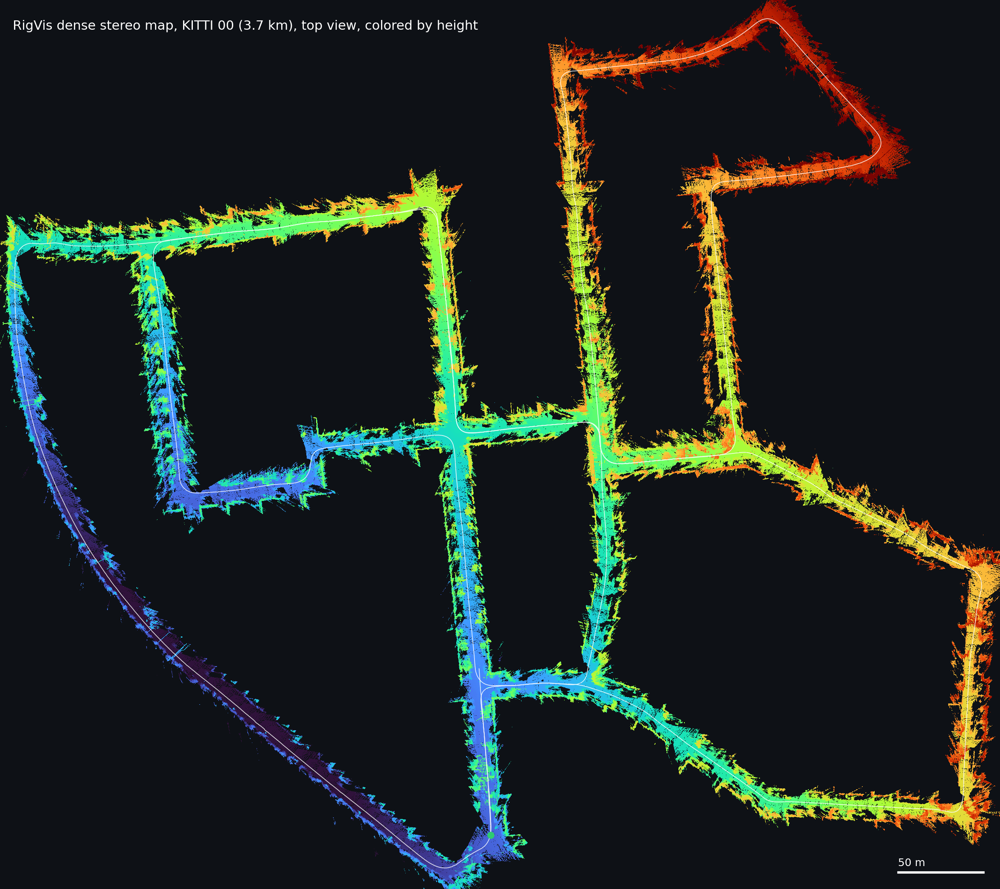
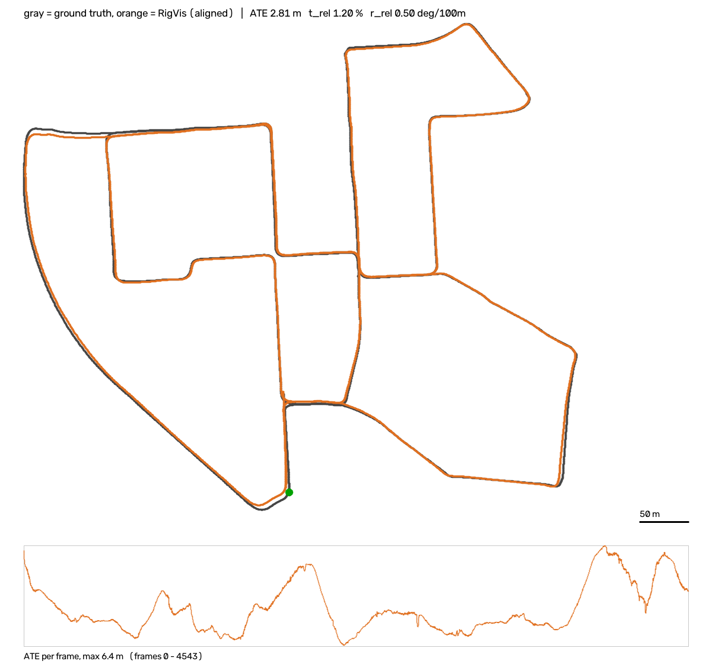
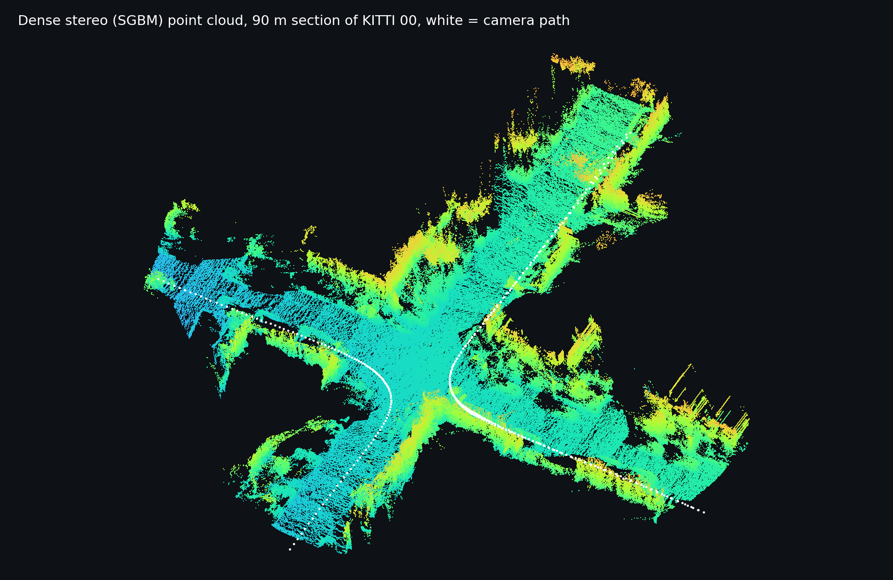
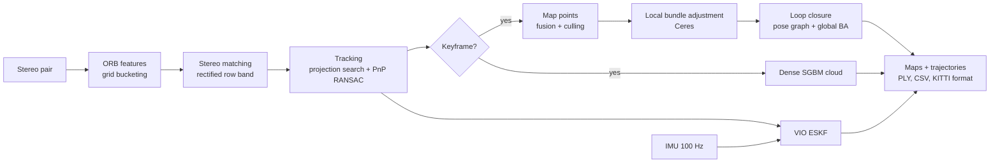

# RigVis: Stereo-Inertial SLAM in C++

RigVis is a stereo visual SLAM system with IMU fusion, written from scratch in C++17
(Eigen, OpenCV, Ceres). It tracks a stereo camera, builds a sparse and a dense 3D map,
closes loops, fuses the IMU in an error-state Kalman filter and evaluates itself
against ground truth.

Tested on KITTI raw `2011_10_03_drive_0027` (= KITTI odometry sequence 00, 4544 frames, 3.7 km).



## Results (KITTI 00, full sequence)

| | t_rel | r_rel | ATE (RMSE) | RPE / frame |
|---|---|---|---|---|
| **RigVis** | **1.20 %** | **0.50 °/100 m** | **2.81 m** | 0.057 m, 0.100 ° |
| ORB-SLAM2 stereo (reference, from the paper) | 0.70 % | 0.25 °/100 m | 1.3 m | |

- `t_rel`, `r_rel`: official KITTI odometry metric (drift over 100 to 800 m sub-paths).
- ATE: absolute trajectory error after a rigid (no scale) alignment.
- Ground truth: KITTI OXTS GPS/INS, converted with the KITTI devkit method.



Gray: ground truth. Orange: RigVis. Bottom: position error per frame.



## Pipeline



### Frontend
- ORB features with grid bucketing, stereo matching along rectified rows.
- Constant-velocity motion model, projection search against a covisibility-based local map,
  PnP RANSAC, fallback tracker against the previous frame.
- Quality-based keyframe selection (tracked ratio, interval, minimum tracked points).

### Mapping
- Covisibility graph, map point fusion and culling.
- Local bundle adjustment in Ceres: stereo (3 residuals) and mono (2 residuals)
  reprojection errors, Huber loss, chi² outlier rejection, octave-dependent sigma.
- Map points and dense clouds are anchored to keyframes, so every correction moves them along.

### Loop closure
- Candidates by proximity, verified with PnP (≥ 60 inliers) and a consistency check.
- SE(3) pose graph optimization, duplicate point fusion, global bundle adjustment.
- The final trajectory rebuilds every frame from the corrected keyframes.

### Visual-inertial fusion (ESKF)
- Robocentric error-state Kalman filter: the reference frame is the IMU frame at the
  previous camera frame, so the unobservable absolute position and heading are never in
  the state (avoids the classic EKF-VIO inconsistency).
- State: rotation, position, velocity, gyro and accelerometer biases, gravity (18 error states).
- IMU propagation at 100 Hz, VO frame-to-frame motion as the measurement, chi² gating.
- Initialization while moving: linear visual-inertial alignment (velocity and gravity by
  least squares over a 2 s window), separate path for a static start.
- Handles IMU dropouts (the KITTI 100 Hz data has gaps up to 1.9 s) and the IMU-camera time offset.

### Dense mapping and export
- Semi-global matching (OpenCV SGBM) on keyframes, 1 to 20 m depth, merged on a 10 cm voxel grid.
- Exports: `map_dense.ply`, `map_sparse.ply`, `map_cameras.ply` (CloudCompare, MeshLab,
  Metashape, Blender), `keyframes.csv` with positions and omega/phi/kappa.
- Colors: height (Turbo colormap) or RGB from the KITTI color camera when `image_02` exists.

### Evaluation (C++)
- Ground truth from OXTS, ATE (Umeyama alignment), KITTI t_rel / r_rel, RPE, plots.
- `frame_stats.csv` and `fusion_stats.csv` log every frame (matches, inliers, BA, loops, filter residuals, biases).

## Build

Requirements: CMake ≥ 3.30, a C++17 compiler, Eigen 3, OpenCV (5.x module names in
`CMakeLists.txt`; for OpenCV 4 use `opencv_features2d` and `opencv_calib3d`), Ceres Solver.

```bash
# macOS
brew install eigen opencv ceres-solver

git clone https://github.com/ekrrems/Stereo-inertial-slam.git
cd Stereo-inertial-slam
mkdir build && cd build
cmake ..          # Release by default
make -j
```

## Data

Download from the [KITTI raw data](https://www.cvlibs.net/datasets/kitti/raw_data.php) page, drive `2011_10_03_drive_0027`:
- the synced+rectified data (`*_sync`) and the calibration files of `2011_10_03`,
- optionally the unsynced data (`*_extract`) for the 100 Hz IMU.

## Run

Paths live in a git-ignored config file:

```bash
cp config/rigvis.example.yaml config/rigvis.yaml   # set dataset_path (and imu_path)
cd build
./rigvis_dataset_runner                             # or: ./rigvis_dataset_runner my_config.yaml
```

Outputs (in the folder you run from): `trajectory_kitti.txt` (online), `trajectory_vio.txt`,
`trajectory_final.txt`, `trajectory_eval*.png`, `evaluation_results.csv`, the PLY maps and the CSV logs.

Re-evaluate a saved trajectory without running the SLAM again:

```bash
./rigvis_evaluate trajectory_final.txt /path/to/2011_10_03_drive_0027_sync [first_frame] [plot.png]
```

## Repository layout

```
include/, src/
  StereoFrontend      tracking, keyframes, map management
  LocalBundleAdjuster Ceres local BA
  LoopClosing, PoseGraph
  DenseMapper, MapExport
  Estimator           error-state Kalman filter (IMU propagation, VO update)
  VisualInertialFusion  VIO initialization and frame handling
  DataLoader          KITTI raw loader (stereo, color, OXTS, calibration)
  Evaluation          ground truth, ATE, KITTI metrics, plots
tools/rigvis_evaluate.cpp
config/rigvis.example.yaml
```

## Roadmap

- IMU as the motion prior for tracking, then IMU preintegration factors in local BA (tightly coupled).
- Bag-of-words loop detection.
- Semantic map: per-pixel segmentation lifted into the 3D map, queryable objects.
- Gazebo / PX4 drone simulation and multi-drone map merging.
